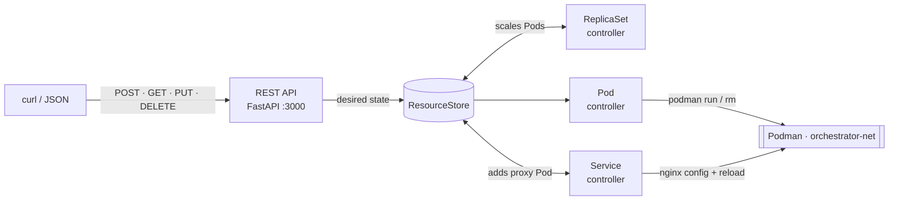

# mini-k8s-orchestrator

**A small Kubernetes you can read in an afternoon.** Pods, ReplicaSets and Services run as real Podman containers, kept alive by reconcile loops.

Tell it what you want. Kill a container. Watch it come back.



## What it does

- **Pods** become real containers, reachable from other pods by name.
- **ReplicaSets** keep N copies running. Change `replicas` with a PUT to scale.
- **Services** get an nginx proxy that round-robins HTTP requests across matching pods, reachable by the Service name and on the host port.
- **Self-healing:** every second, each controller compares desired state with what Podman is actually running, and fixes the difference.
- **Spec changes:** each container carries a SHA-256 of its pod spec. Change the spec and the container is replaced.

## Try it (60 seconds)

Needs Linux, [Podman](https://podman.io), Python ≥ 3.10 and [uv](https://docs.astral.sh/uv/).

```bash
uv run orchestrator.py            # API on http://localhost:3000
```

In another terminal:

```bash
API=http://localhost:3000

# 3 nginx replicas
curl -X POST $API/api/apps/v1/namespaces/default/replicasets -H 'Content-Type: application/json' -d '{
  "apiVersion": "apps/v1", "kind": "ReplicaSet", "metadata": {"name": "web"},
  "spec": {"replicas": 3, "selector": {"app": "web"},
    "template": {"metadata": {"labels": {"app": "web"}},
      "spec": {"containers": [{"name": "nginx", "image": "docker.io/library/nginx:alpine"}]}}}}'

# a Service in front of them
curl -X POST $API/api/v1/namespaces/default/services -H 'Content-Type: application/json' -d '{
  "apiVersion": "v1", "kind": "Service", "metadata": {"name": "web-svc"},
  "spec": {"selector": {"app": "web"}, "ports": [{"port": 8080, "targetPort": 80}]}}'

sleep 5 && curl localhost:8080    # "Welcome to nginx!", load-balanced across 3 pods

# break something...
podman rm -f default_web-1_nginx

# ...and watch it heal
sleep 3 && podman ps --filter label=managed-by=my-orchestrator --format '{{.Names}}'
```

## Tests

116 tests, from pure unit tests to end-to-end runs with real containers, including a mocked Podman runtime with failure injection.

```bash
uv run pytest                     # everything; Podman tests skip if Podman is missing
uv run pytest tests/test_controllers.py tests/test_controllers_mock.py \
              tests/test_store.py tests/test_resources.py     # no Podman needed
```

## Known limits

- The store lives in memory: a restart forgets the desired state and cleans up every running container as an orphan.
- Services proxy HTTP only (layer 7), not raw TCP or UDP.
- Single machine, no authentication on the API.

## More

- [ARCHITECTURE.md](ARCHITECTURE.md): every flow, step by step
- [tests.md](tests.md): what each test checks
